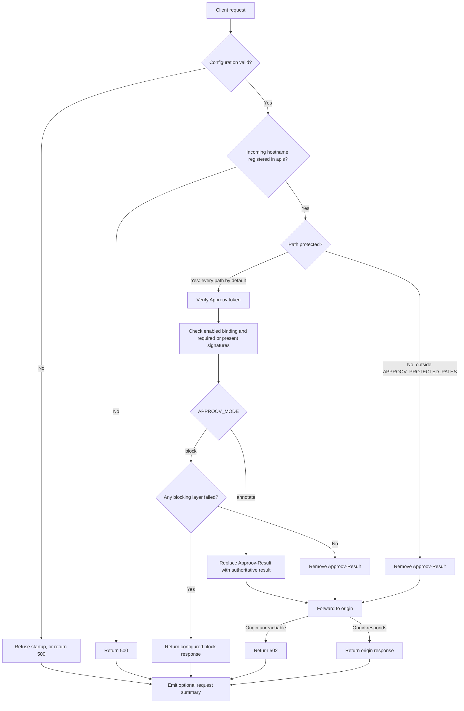
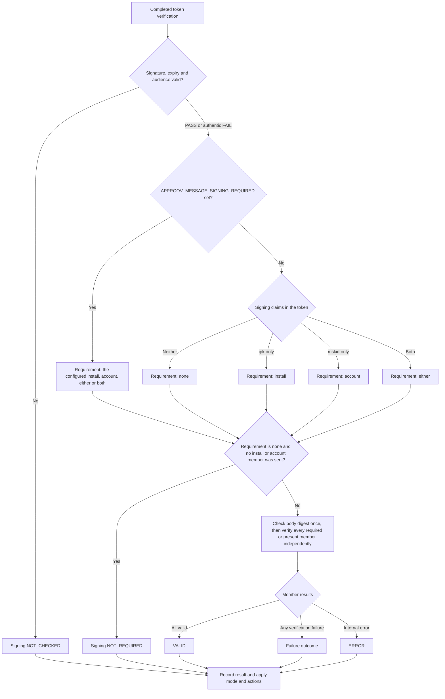

# Approov Cloudflare Worker


[](https://deploy.workers.cloudflare.com/?url=https://github.com/approov-beta/approov-verifier-cloudflare-worker)

> [!NOTE]
> Copyright © 2026 Approov Limited. Released under the [MIT License](LICENSE).
> Customer-specific confidential logic is not part of this repository: Approov delivers it
> separately as [drop-in plugins](#plugins).

A reverse-proxy [Cloudflare Worker](https://developers.cloudflare.com/workers/) that
verifies [Approov](https://approov.io) attestation tokens at the edge, annotates each
request in annotation mode, or applies explicit protection actions in block mode.

---

## Table of Contents

- [How It Works](#how-it-works)
- [What the Worker Verifies](#what-the-worker-verifies)
- [Request Flow](#request-flow)
- [Prerequisites](#prerequisites)
- [Quickstart (Wrangler)](#quickstart-wrangler)
  - [1. Install dependencies](#1-install-dependencies)
  - [2. Log in to Wrangler](#2-log-in-to-wrangler)
  - [3. Register the gateway domain with Approov](#3-register-the-gateway-domain-with-approov)
  - [4. Retrieve your Approov configuration](#4-retrieve-your-approov-configuration)
  - [5. Upload the Approov secret](#5-upload-the-approov-secret)
  - [6. Validate configuration](#6-validate-configuration)
  - [7. Configure your upstream API](#7-configure-your-upstream-api)
  - [8. Generate example tokens](#8-generate-example-tokens)
  - [9. Test locally](#9-test-locally)
  - [10. Publish](#10-publish)
- [Configuration Reference](#configuration-reference)
  - [Secrets (key material)](#secrets-key-material)
  - [Environment variables (`[vars]`)](#environment-variables-vars)
- [Operation Modes](#operation-modes)
- [The `Approov-Result` Header](#the-approov-result-header)
- [Feature Guides](#feature-guides)
  - [Token audience checks](#token-audience-checks)
  - [Migrating from the default account secret](#migrating-from-the-default-account-secret)
  - [Rotating a keyset key](#rotating-a-keyset-key)
  - [Rotating ARC encoding secrets](#rotating-arc-encoding-secrets)
  - [Token binding checks](#token-binding-checks)
  - [Message signing checks](#message-signing-checks)
  - [Customizing the rejection response](#customizing-the-rejection-response)
- [Plugins](#plugins)
- [Custom Deployment Scenarios](#custom-deployment-scenarios)
- [Debugging](#debugging)
- [Troubleshooting](#troubleshooting)
- [Codebase Structure](#codebase-structure)
- [Testing](#testing)
- [Outcome Reference](#outcome-reference)
- [Useful Links](#useful-links)

---

## How It Works

The worker sits in front of your API as a reverse proxy. For every request it:

1. Reads the Approov token from a configurable header (default `Approov-Token`).
2. Verifies the token signature against your **pass** and **fail** key sets.
3. Optionally decodes the `arc` claim, checks token binding, and verifies RFC 9421 message signatures.
4. In `annotate` mode, forwards every request with `Approov-Result`.
5. In `block` mode, applies each layer's action and never forwards `Approov-Result`.

Set `APPROOV_MODE` explicitly. See [Operation Modes](#operation-modes).

---

## What the Worker Verifies

The data stream of an Approov attestation is carried inside the token. Broadly there are
three questions to answer:

| Question | How it is answered |
|---|---|
| **Was the token issued by Approov?** | A passing attestation is signed by the Approov **Pass** secret; a failing attestation by the **Fail** secret; anything else is tampering. |
| **Did attestation pass or fail?** | Determined by which key set verifies the signature (`PASS` vs `FAIL`). |
| **Which device property flags are present?** | Encoded in the `arc` (Attestation Response Code) claim, decoded with the ARC encoding secret. |

> [!WARNING]
> ARC flags include their own pass/fail signal, but the **token signature must still be
> verified**. Otherwise an attacker could embed a passing ARC into a JWT re-signed with
> their own key material.

**Token binding** ties a token to a specific client session or piece of request data
(such as the `Authorization` header). **Message signing** cryptographically proves that
request headers and/or the body were not tampered with in transit. Token binding is optional. Deployment requirements select message signing; trusted claims supply its keys — see the [feature guides](#feature-guides).

---

## Request Flow



Two diagnostic paths are left out of the diagram. With `APPROOV_ECHO_MODE` the Worker replies
with the rewritten request instead of forwarding it. With `API_PASSTHROUGH` a forwarded request
that comes back to the Worker is answered with `508 Loop Detected`.

The message-signing requirement comes from `APPROOV_MESSAGE_SIGNING_REQUIRED`, or from the
token's claims when that setting is unset:



With `either`, at least one of the two members must be sent, and every member that is sent
must verify. See [message signing checks](#message-signing-checks) for the full rules.

---

## Prerequisites

- A working `node` and `npm` environment (**Node.js 22+**, as required by Wrangler 4).
- An Approov account and the [Approov CLI](https://ext.approov.io/docs/latest/approov-installation/)
  **version 3.6.0 or later** ([approovcli.zip](https://approov.io/downloads/approovcli.zip)).
  The account must be configured to use an ECDSA or RSA key pair for signing and verifying
  tokens — see [Managing Key Sets](https://ext.approov.io/docs/latest/approov-usage-documentation/#managing-key-sets).
- A Cloudflare account with a Worker entitlement.
- Optionally, the ability to grant [Wrangler](https://developers.cloudflare.com/workers/wrangler/)
  access to your Cloudflare account if you intend to deploy via the `wrangler` CLI.

> [!NOTE]
> This quickstart starts on your free `*.<CF_SUBDOMAIN>.workers.dev` subdomain (found at the
> bottom of the **Workers & Pages** dashboard). The default worker name is **`approov-gateway`**
> — edit the `name` field in [`wrangler.toml`](wrangler.toml) before deploying if you prefer a
> different name. Two placeholders are used throughout this guide:
>
> - `$(WORKER_NAME)` — the worker name, default `approov-gateway`.
> - `$(WORKER_DOMAIN)` — your subdomain, e.g. `your-subdomain.workers.dev`.

---

## Quickstart (Wrangler)

> [!NOTE]
> The commands below assume a POSIX shell. On Windows, follow the
> [Windows quickstart (PowerShell)](docs/windows-quickstart.md), which covers the same steps
> with the required PowerShell equivalents.

### 1. Install dependencies

```shell
npm install
```

### 2. Log in to Wrangler

```shell
npx wrangler login
```

A browser window opens asking you to authorize Wrangler against your Cloudflare account.

### 3. Register the gateway domain with Approov

Register the Worker's final public domain with Approov before exporting the backend
configuration. Use the Key ID from the keyset configured for this API:

```shell
approov api -add $(WORKER_NAME).$(WORKER_DOMAIN) -keySetKID "example-es256"
```

The default domain is `approov-gateway.<CF_SUBDOMAIN>.workers.dev`. If you will use a custom
domain instead, register that exact hostname. Changing the Worker name or public hostname later
requires updating the Approov API registration and exporting the configuration again.

### 4. Retrieve your Approov configuration

Use the Approov CLI (version 3.6.0 or later) to export your backend configuration:

```shell
approov secret -getBackendConfig approov-config.json
```

This writes `approov-config.json` containing your key sets, ARC encoding secrets, and API
domain mappings. Confirm that `apis` contains the exact hostname registered in step 3 before
continuing:

```json
{
  "currentArcEncodingSecret": "ObfuscatedCurrentSecret",
  "pendingArcEncodingSecret": "ObfuscatedPendingSecret",
  "previousArcEncodingSecrets": [
    {
      "secret": "ObfuscatedPreviousSecret",
      "timestamp": "2026-04-08T12:19:30+01:00"
    }
  ],
  "defaultPassJWKS": {
    "keys": [
      { "alg": "A256GCMKW", "k": "ObfuscatedSymmetricKey",  "kid": "default_A256GCMKW", "kty": "oct", "use": "enc" },
      { "alg": "HS256",     "k": "ObfuscatedSymmetricKey2", "kid": "default_HS256",      "kty": "oct", "use": "sig" }
    ]
  },
  "passJWKS": {
    "keys": [
      { "alg": "ES256", "crv": "P-256", "kid": "example-es256", "kty": "EC", "use": "sig", "x": "ObfuscatedPassKeyX", "y": "ObfuscatedPassKeyY" }
    ]
  },
  "failJWKS": {
    "keys": [
      { "alg": "ES256", "crv": "P-256", "kid": "example-es256", "kty": "EC", "use": "sig", "x": "ObfuscatedFailKeyX", "y": "ObfuscatedFailKeyY" }
    ]
  },
  "arcFlagMappings": { "1": "debug", "2": "scan-fail" },
  "apis": {
    "$(WORKER_NAME).$(WORKER_DOMAIN)": {
      "kid": "example-es256",
      "isPassKeyPresent": true,
      "isFailKeyPresent": true,
      "comment": "API uses a key ID present in both the pass and fail key sets"
    }
  }
}
```

> [!IMPORTANT]
> **Key ID (KID) requirement.** For normal operation, your gateway domain (e.g.
> `$(WORKER_NAME).$(WORKER_DOMAIN)`) must map to a Key ID (such as `example-es256`)
> present in **both** `passJWKS` and `failJWKS`. A domain without a KID uses the
> account-wide HS256 default secret and is rejected unless the temporary
> `APPROOV_ACCEPT_DEFAULT_ACCOUNT_SECRET` compatibility switch is enabled.

### 5. Upload the Approov secret

Save the file as `approov-config.json` in the project root, then upload it as a single
encrypted Worker secret. The repository ignores this and common environment-specific
config filenames so that the exported key material cannot be committed accidentally:

```shell
npx wrangler secret put APPROOV_BACKEND_CONFIG < approov-config.json
```

> [!NOTE]
> A single, complete `APPROOV_BACKEND_CONFIG` secret is **required** — it keeps all key
> material in one encrypted variable and avoids fragile TOML/JSON escaping. It is the worker's
> sole source for `defaultPassJWKS`, `passJWKS`, `failJWKS`, `apis`, and ARC configuration.
> The `[secrets]` declaration in `wrangler.toml` makes Wrangler refuse a deployment when this
> binding has not been configured.

### 6. Validate configuration

Use the repository commands for development and deployment. They validate the selected configuration,
environment, and variable overrides before starting Wrangler.

```shell
npm run validate:config
npm run deploy -- --dry-run
```

Policy validation always runs. If `approov-config.json` exists beside the selected Wrangler file,
the preflight also validates its contents. Development loads local secrets through Wrangler.
Worker initialization validates the deployed bindings, including stored secrets, and refuses invalid configuration.

### 7. Configure your upstream API

`API_DOMAIN` is an environment variable, defined in the `[vars]` block of
[`wrangler.toml`](wrangler.toml). For this quickstart we use the
[Postman Echo API](https://postman-echo.com), which reflects request headers back in its
JSON response so you can inspect what the worker forwarded:

```toml
[vars]
APPROOV_MODE = "annotate"
API_DOMAIN = "postman-echo.com"
```

> [!NOTE]
> The upstream can be **any internet-accessible domain** — it is not restricted to Cloudflare
> zones. A private Worker through a [service binding](https://developers.cloudflare.com/workers/runtime-apis/bindings/service-bindings/)
> requires a source extension. This version always uses global `fetch()`; declaring a binding
> alone does not select it as the upstream.
> The request path is forwarded unchanged. When testing against Postman Echo, request one of
> its echo endpoints, such as `/get` for a `GET` or `/post` for a `POST`. The root path `/`
> is not an echo endpoint there.

> [!WARNING]
> An internet-accessible production origin must not be directly bypassable. In the default
> annotation mode, the backend trusts `Approov-Result` only because ingress controls guarantee
> that this Worker removed any client value and attached the authoritative result. Follow
> [Backend Enforcement and Trusted Ingress](docs/backend-enforcement.md) before going live.
> That guide also requires cache bypass before backend enforcement. The annotation request's
> `cache: 'no-store'` does not guarantee bypass of another Cloudflare zone's cache.

### 8. Generate example tokens

For testing, generate a valid and an invalid token:

```shell
# Valid token
approov token -genExample $(WORKER_NAME).$(WORKER_DOMAIN)

# Invalid token
approov token -genExample $(WORKER_NAME).$(WORKER_DOMAIN) -type invalid
```

Save both for the test steps below.

> [!NOTE]
> CLI example tokens expire after **2 hours** (`-genLongLived <seconds>` extends this).
> **Never generate long-lived valid tokens for a production account.** You can inspect a
> token's `exp` claim by pasting it into [jwt.io](https://jwt.io) — a valid signature is not
> required to read the claims.

### 9. Test locally

Cloudflare [secrets](https://developers.cloudflare.com/workers/configuration/secrets/) are
**not** available in local development, so provide them via a `.dev.vars` file (in
[dotenv](https://hexdocs.pm/dotenvy/dotenv-file-format.html) syntax):

```shell
cp .dev.vars.example .dev.vars
# then edit .dev.vars and paste your real key material
```

Run the worker:

```shell
npm start
```

It listens on port 8787. Because the worker resolves verification policy from the incoming
hostname, make the local request with the same registered gateway hostname while resolving it
to localhost:

```shell
# Valid token → tokenResult: PASS
curl --resolve "$(WORKER_NAME).$(WORKER_DOMAIN):8787:127.0.0.1" \
  "http://$(WORKER_NAME).$(WORKER_DOMAIN):8787/get" --compressed \
  -H "Approov-Token: $VALID_APPROOV_TOKEN" \
  | jq -r '.headers."approov-result"' | base64 -d | jq
```

```jsonc
{
  "tokenResult": "PASS",
  "bindingResult": "DISABLED",
  "messageSigningMode": "none",
  "messageSigningResult": "NOT_REQUIRED",
  // ...
}
```

```shell
# Invalid token → tokenResult: FAIL
curl --resolve "$(WORKER_NAME).$(WORKER_DOMAIN):8787:127.0.0.1" \
  "http://$(WORKER_NAME).$(WORKER_DOMAIN):8787/get" --compressed \
  -H "Approov-Token: $INVALID_APPROOV_TOKEN" \
  | jq -r '.headers."approov-result"' | base64 -d | jq
```

```jsonc
{
  "tokenResult": "FAIL",
  // ...
}
```

> [!TIP]
> The `approov-result` key appears in the `curl` output only because Postman Echo reflects
> request headers back. The worker attaches the header to the **upstream request**, not the
> client response. See [The `Approov-Result` Header](#the-approov-result-header).

### 10. Publish

Attach a source version tag to each deployment. From a Git checkout, use:

```shell
npm run deploy -- --tag "$(git describe --tags --always --dirty)"
```

Git returns a release tag, a tag plus subsequent commits, or a commit ID.
Modified tracked files add `-dirty` to the label.

For PowerShell, use:

```powershell
$workerVersion = git describe --tags --always --dirty
npm run deploy -- --tag $workerVersion
```

For ZIP downloads, replace the example tag with the release version you downloaded:

```shell
npm run deploy -- --tag v2.0.0
```

Cloudflare displays the tag under **Workers & Pages → your Worker → Deployments**.
Cloudflare also assigns a version ID for the uploaded code and configuration.
Dashboard visibility does not require a runtime metadata binding.
See [Cloudflare versions and deployments](https://developers.cloudflare.com/workers/versions-and-deployments/)
and the [Wrangler deployment options](https://developers.cloudflare.com/workers/wrangler/commands/workers/).

Your gateway is now live at `$(WORKER_NAME).$(WORKER_DOMAIN)`. Re-run the `curl` commands
from step 9 against the deployed URL to confirm.

---

## Configuration Reference

### Secrets (key material)

Set with `wrangler secret put APPROOV_BACKEND_CONFIG` (or, locally, in `.dev.vars`). The worker
loads all Approov JWKS and ARC configuration from this single encrypted value.

| Secret | Required | Description |
|---|---|---|
| `APPROOV_BACKEND_CONFIG` | Required | Complete CLI-exported config. Supplies default/pass/fail JWKS, per-domain API assignments, current/pending/previous ARC secrets, and ARC mappings in one encrypted value. |
| `APPROOV_ACCOUNT_MESSAGE_SIGNING_SECRET` | When checking account signatures | Account message-signing secret (raw, base64, or base64url — auto-detected). Account signatures use a device key derived from these secret bytes. |

> **Why a single secret?** Sensitive material is encrypted at rest by Cloudflare, never
> committed to source control or stored in plaintext in `wrangler.toml`, and you avoid
> escaping JSON key sets inside TOML.

### Environment variables (`[vars]`)

Defined in [`wrangler.toml`](wrangler.toml). **Restart the worker after changing any value.**

<details>
<summary><strong>Upstream</strong></summary>

| Variable | Default | Description |
|---|---|---|
| `API_DOMAIN` | _(required unless `API_PASSTHROUGH`)_ | Upstream target domain. Must not be set when `API_PASSTHROUGH = "true"`. |
| `API_PORT` | `443` | Upstream port. Ignored under `API_PASSTHROUGH`. |
| `API_PASSTHROUGH` | `false` | Forward to the hostname the request arrived on, so one deployment can protect several API hostnames. **Worker Route topology only** — see [deployment topologies](docs/deployment-topologies.md). |

</details>

<details>
<summary><strong>Mode and actions</strong></summary>

| Variable | Default | Rule |
|---|---|---|
| `APPROOV_MODE` | Required | `annotate` or `block`; no implicit default. |
| `APPROOV_TOKEN_ACTION` | Required in block mode | `block` or `continue`. |
| `APPROOV_MESSAGE_SIGNING_ACTION` | Required in block mode | `block` or `continue`. |
| `APPROOV_TOKEN_BINDING_ACTION` | Required when binding is enabled in block mode | `block` or `continue`; prohibited otherwise. |
| `APPROOV_BLOCK_RESPONSE_STATUS` | `403` | Block mode only; integer from 200 to 599. |
| `APPROOV_BLOCK_RESPONSE_BODY` | `Forbidden` | Block mode only; string. |
| `APPROOV_PROTECTED_PATHS` | unset (every path) | Comma-separated path prefixes to check; `*` stands for one path segment, so `/shop/*/*/checkout` covers every market. An entry matches its path and everything below it: `/api` covers `/api` and `/api/users`, and `/api/*` covers only what is below `/api`. Matching ignores case, percent-encoding, duplicate slashes and `;` path parameters, and also covers a suffix such as `/checkout.json`. Other paths are forwarded unchecked and unannotated. Each entry must start with `/` and must not end with `/`. |

Annotation mode prohibits all action and block-response variables, including empty values.
Both actions run checks. `continue` forwards a failed result; `block` rejects it.

</details>

<details>
<summary><strong>Token verification</strong></summary>

| Variable | Default | Description |
|---|---|---|
| `APPROOV_TOKEN_HEADER_NAME` | `"Approov-Token"` | Header carrying the Approov token. |
| `APPROOV_STATUS_HEADER_NAME` | `"Approov-Status"` | Header carrying the client token-fetch status. Match the service layer configuration. |
| `APPROOV_TOKEN_AUDIENCE` | _(unset)_ | If set, the token's `aud` claim must match. |
| `APPROOV_TOKEN_AUDIENCE_FROM_HOST` | `"false"` | If `"true"`, the token's `aud` claim must match the hostname of the incoming request. Cannot be combined with `APPROOV_TOKEN_AUDIENCE`. |
| `APPROOV_ACCEPT_DEFAULT_ACCOUNT_SECRET` | `false` | Deployment-wide migration switch. `true` accepts valid default HS256 tokens and exported pass/fail keyset pairs; return it to `false` after cached default tokens expire. |

`APPROOV_ACCEPT_DEFAULT_ACCOUNT_SECRET = "false"` is the normal, secure mode:

- Only the exact keyset KID assigned to the incoming API domain is accepted.
- Default HS256 account-secret tokens are rejected.
- Requests for a domain still configured with the default account secret return a
  configuration error.

`APPROOV_ACCEPT_DEFAULT_ACCOUNT_SECRET = "true"` is temporary migration mode:

- Valid default HS256 tokens are accepted with either no KID or the exported `_HS256` KID.
- Any exact keyset KID present in both exported `passJWKS` and `failJWKS` is also accepted.
- Old cached tokens and new keyset tokens can therefore overlap safely.
- A startup warning is emitted because compatibility applies to the entire Worker deployment.

The migration flow is: set the switch to `true`, move the APIs to keysets, wait for old cached
tokens to expire, and then set it back to `false`.

</details>

The worker accepts signing JWKs declared as `HS256`/`oct`, `ES256`/`EC P-256`,
or `RS256`/`RSA`. Encryption-only keys such as `A256GCMKW` are ignored; JWE is
not supported. Every verification attempt is pinned to the selected JWK's
declared algorithm and key type.

<details>
<summary><strong>Token binding</strong></summary>

| Variable | Default | Description |
|---|---|---|
| `APPROOV_TOKEN_BINDING_ENABLED` | `false` | Enable token-binding verification. |
| `APPROOV_TOKEN_BINDING_HEADER_NAME` | `"Authorization"` | Header whose value is bound to the token. |
| `APPROOV_TOKEN_BINDING_CLAIM_NAME` | `"pay"` | Token claim holding the bound (hashed) value. |

</details>

<details>
<summary><strong>Message signing</strong></summary>

| Variable | Default | Description |
|---|---|---|
| `APPROOV_MESSAGE_SIGNING_REQUIRED` | _(unset)_ | Require `install`, `account`, `either`, or `both` for every trusted token. Unset preserves token-only compatibility; see [message signing checks](#message-signing-checks). |
| `APPROOV_MESSAGE_SIGNING_TOLERANCE_SECONDS` | `60` | Allowed clock skew for `created`/`expires`. |
| `APPROOV_MESSAGE_SIGNING_MAX_BODY_BYTES` | `1048576` | Max body bytes consumed while checking `Content-Digest`. |
| `APPROOV_ACCOUNT_MESSAGE_SIGNING_KEY_ID` | _(unset)_ | If set, must match `mskid` whenever an account signature is checked. Does not itself require an account signature. |

</details>

<details>
<summary><strong>Diagnostics</strong></summary>

| Variable | Default | Description |
|---|---|---|
| `APPROOV_DEBUG` | `false` | Emit detailed `approov:` debug logs. |
| `APPROOV_ECHO_MODE` | `false` | Reply with the (rewritten) request as JSON instead of forwarding upstream. Credential headers are redacted. **Testing only.** |
| `APPROOV_ANALYTICS_ENABLED` | `false` | Write core outcomes to the optional `APPROOV_ANALYTICS` dataset binding. |
| `APPROOV_LOGGING_ENABLED` | `false` | Log every request result, including individual signatures and safe plugin summaries. Independent of Analytics Engine. |

</details>

---

## Operation Modes

| Mode | Protection failures | Origin request |
|---|---|---|
| `annotate` | Always forward | Replace any client `Approov-Result` with the Worker's result. |
| `block` | Apply each layer's `block` or `continue` action | Never forward `Approov-Result`. |

The example configuration explicitly selects annotation mode. To enforce at the edge, replace its mode and add actions:

```toml
APPROOV_MODE = "block"
APPROOV_TOKEN_ACTION = "block"
APPROOV_MESSAGE_SIGNING_ACTION = "block"
APPROOV_TOKEN_BINDING_ENABLED = "true"
APPROOV_TOKEN_BINDING_ACTION = "block"
```

Any failed blocking layer rejects the request. `ERROR` and unavailable required checks also fail.
Disabled binding and signing `NOT_REQUIRED` are acceptable. All actions can be `continue`.

In annotation mode, the backend must require `tokenResult=PASS`, binding `VALID` or `DISABLED`,
and signing `VALID` or `NOT_REQUIRED`. Reject missing, malformed, or non-passing annotations.
See [backend enforcement](docs/backend-enforcement.md). Update older middleware that accepts signing `DISABLED`.
Block mode requires a backend ingress that trusts the Worker; result-header middleware applies to annotation mode only.

`APPROOV_LOGGING_ENABLED="true"` emits one structured summary per request in either mode.
`APPROOV_DEBUG` controls additional diagnostics. Errors and warnings remain enabled.
See [Worker analytics](docs/worker-analytics-proposal.md).

### Configuration validation

Use exact lowercase mode/action values and booleans `true`, `false`, `"true"`, or `"false"`.
Unknown `APPROOV_` names, removed variables, malformed values, and conflicting combinations are errors.
Plugin variables are accepted only when their plugin is installed and declares them.

`npm run validate:config` checks configuration even without a local backend export.
`npm run deploy -- --env staging` and `npm run versions:upload -- --config other.toml`
validate the selected configuration and command-line overrides before invoking Wrangler.
`npm start` also validates the local bindings and secrets that Wrangler loads.

The Worker validates actual bindings during initialization and refuses invalid uploads.
It uses Cloudflare's [global binding access](https://developers.cloudflare.com/workers/runtime-apis/bindings/#importing-env-as-a-global).
Cloudflare checks [top-level execution during uploads](https://developers.cloudflare.com/workers/observability/errors/#validation-errors-10021).
A request-time guard also rejects invalid binding changes with HTTP 500 before contacting the origin.
Local preflight cannot read existing encrypted Cloudflare secret values; initialization validates their contents.

---

## The `Approov-Result` Header

For each request the worker computes a verification result and (when annotating) attaches it
as the `Approov-Result` header on the **upstream** request. The value is **base64-encoded
JSON** with these fields:

| Field | Type | Description |
|---|---|---|
| `tokenResult` | string | Token outcome — see [Outcome Reference](#outcome-reference). |
| `clientStatus` | string \| null | Client token-fetch status, filtered to known lowercase SDK status names. Missing headers produce `null`. Other values produce `invalid`. |
| `bindingResult` | string | Binding outcome — see [Outcome Reference](#outcome-reference). |
| `messageSigningMode` | string | `none` \| `install` \| `account` \| `either` \| `both` \| `unknown`. Explicit requirement or compatibility requirement from trusted claims. |
| `messageSigningResult` | string | Message-signing outcome — see [Outcome Reference](#outcome-reference). |
| `messageSigningVerification` | object \| null | Detail object (`ok`, `status`, `mode`, `signatureName`, `error`, `signatures`). `signatures.install` and `.account` contain individual results or `null`, or `null` when not run. |
| `tokenVerification` | object \| null | `{ ok, status, decoded, verification }`; `verification` is populated only after signature verification and identifies the API domain, key source, algorithm, and KID. |
| `arcProperties` | string[] \| null | Decoded ARC properties (`pass`/`fail` first), or `null` when no `arc` claim was present. |

`clientStatus` is a client diagnostic. It never changes token verification or enforcement.
A request with `clientStatus: success` and no valid token still fails token verification.
Unknown, repeated, empty, and oversized status values produce `invalid`. The Worker does not log their raw values.
Structured request logs also contain `clientStatus`. Analytics Engine schema version 3 adds this value in `blob11`.
Before rollout, update version-specific log and analytics consumers. See the [analytics migration notes](docs/worker-analytics-proposal.md#analytics-engine-columns).

Decode the result like this:

```shell
curl ... | jq -r '.headers."approov-result"' | base64 -d | jq
```

```jsonc
{
  "tokenResult": "PASS",
  "bindingResult": "DISABLED",
  "messageSigningMode": "none",
  "messageSigningResult": "NOT_REQUIRED",
  "messageSigningVerification": { "ok": true, "status": "NOT_REQUIRED", "mode": "none", "signatureName": null, "error": null, "signatures": { "install": null, "account": null } },
  "tokenVerification": {
    "ok": true,
    "status": "PASS",
    "decoded": { "exp": 1766072633, "ip": "1.2.3.4", "did": "ExampleApproovTokenDID==" },
    "verification": {
      "apiDomain": "approov-gateway.example.workers.dev",
      "source": "passJWKS",
      "algorithm": "ES256",
      "keyId": "example-es256"
    }
  },
  "arcProperties": ["pass"]
}
```

> [!NOTE]
> The header is added to the request sent to `API_DOMAIN`; it is **not** automatically added
> to the client response. In this quickstart you see it because Postman Echo reflects request
> headers back in its JSON body.

---

## Feature Guides

Use the workflow that matches the material being changed:

| Situation | Compatibility switch | What overlaps |
|---|---|---|
| Keyset API, no rotation | `false` | Only the KID assigned to the incoming API domain is accepted. |
| Keyset-to-keyset rotation | Temporarily `true` | Old and new KIDs that each exist in both `passJWKS` and `failJWKS`. |
| Default HS256 to keyset migration | Temporarily `true` | Cached default HS256 tokens and the new keyset KID. |
| ARC secret rotation | No change required | Current, pending, and previous ARC encoding secrets. |

> [!IMPORTANT]
> The compatibility switch is deployment-wide. During a keyset rotation it also enables valid
> default account-secret HS256 tokens, even if the API being rotated already uses a keyset.
> Keep the overlap short, verify token audiences where possible, and return the switch to
> `false` after cached old tokens expire. Use separate Worker deployments if different APIs
> require independent rotation windows.

### Token audience checks

With `APPROOV_ACCEPT_DEFAULT_ACCOUNT_SECRET = "false"` the worker accepts only the keyset key
assigned to the incoming API domain. That does not separate domains that are assigned the same
keyset key, and while default-secret compatibility is enabled the account-wide HS256 secret and
every exported pass/fail keyset pair are accepted on every domain. In those cases a token issued
for one domain also verifies on the others. Audience checks close that gap.

Enable audience inclusion on your Approov account so every token carries an `aud` claim set to
the domain it was issued for (wildcard tokens carry `*`):

```shell
approov policy -setAudience on
```

Then choose one of:

- `APPROOV_TOKEN_AUDIENCE_FROM_HOST = "true"` (recommended): the `aud` claim must equal the
  hostname of the incoming request. This works for a worker serving one or several hostnames,
  including pass-through forwarding.
- `APPROOV_TOKEN_AUDIENCE = "<domain>"`: the `aud` claim must equal this fixed value. Use it only
  when the worker serves a single hostname.

The audience is the domain your app calls, which is the worker's own hostname, not
`API_DOMAIN`. Tokens with a missing, empty or `*` audience are rejected. A mismatch yields
`tokenResult: INVALID_AUD`.

Enable the account policy first and deploy the worker setting once tokens with `aud` are being
issued; until then every token would be rejected with `INVALID_AUD`.

Audience checking is strongly recommended while default-secret compatibility is enabled.
The default secret is account-wide, so an HS256 token without a checked audience cannot be
cryptographically restricted to one API domain.

### Migrating from the default account secret

Customers already using a per-API keyset should leave
`APPROOV_ACCEPT_DEFAULT_ACCOUNT_SECRET = "false"`. The worker then accepts only the exact
KID assigned to the incoming hostname in the exported `apis` map.

For a controlled migration:

1. Create the new keyset key without changing the API assignment.
2. Export and deploy the complete transitional backend configuration containing the default
   key and the new keyset pass/fail pair.
3. Set `APPROOV_ACCEPT_DEFAULT_ACCOUNT_SECRET = "true"`. This affects the entire Worker
   deployment and produces a startup warning.
4. Confirm existing HS256 traffic reports `verification.source: "defaultPassJWKS"`.
5. Switch staging and then production API assignments to the new keyset.
6. Monitor until traffic reports only `passJWKS` or `failJWKS` for the new KID.
7. Wait at least the configured Approov token lifetime plus a safety margin, then deploy a
   fresh final CLI export.
8. Set `APPROOV_ACCEPT_DEFAULT_ACCOUNT_SECRET = "false"`. This explicit change completes
   migration and immediately rejects any remaining cached default tokens.

While compatibility is enabled, a token with an exact KID found in both exported keyset
pass/fail sets can be verified before the `apis` assignment changes. Default-secret
verification is pass-only: a bad HS256 signature is `INVALID_SIG`, never a trusted failure
token, and its ARC is not decoded. Rotate the account secret only for an independent security
reason; rotation is not required to complete this migration.

### Rotating a keyset key

Keyset rotation uses a new KID. The old and new pass/fail keys coexist in the exported JWKS
while cached tokens signed with the old key drain. This is different from ARC rotation: there
are no `pendingPassJWKS` or `pendingFailJWKS` fields.

For a rotation without an availability gap:

1. Add the new keyset key with a new KID, but do not change the API assignment yet.
2. Run `approov secret -getBackendConfig approov-config.json`. Confirm that both the old and
   new KIDs occur exactly once in `passJWKS` and exactly once in `failJWKS`.
3. Upload this transitional configuration to the Worker.
4. Temporarily set `APPROOV_ACCEPT_DEFAULT_ACCOUNT_SECRET = "true"`. In this mode the Worker
   can verify the new KID before the exported `apis` assignment changes. Remember that this
   also enables the default account HS256 secret for the whole deployment.
5. Generate valid and invalid example tokens for staging. Confirm both are verified and that
   `tokenVerification.verification.keyId` reports the new KID; the source should be
   `passJWKS` for valid tokens and `failJWKS` for genuine failure tokens.
6. Change the staging API and then the production API to the new keyset KID. Preserve every
   other API option when updating the Approov API configuration.
7. Monitor `tokenVerification.verification.keyId` until the old KID is no longer observed.
8. Wait at least the configured token lifetime plus a safety margin before removing the old
   key from the Approov keyset.
9. Export and deploy the final backend configuration, which should no longer contain the old
   KID.
10. Set `APPROOV_ACCEPT_DEFAULT_ACCOUNT_SECRET = "false"`. Confirm new-KID PASS and FAIL
    traffic continues and old-KID tokens now produce `INVALID_SIG`.

Do not reuse a KID with different key material. The overlap depends on the JWT header selecting
one unambiguous exported pass/fail pair. Audience verification is strongly recommended while
multiple API keysets are accepted by the deployment.

### Rotating ARC encoding secrets

The latest CLI backend export contains the active ARC secret in
`currentArcEncodingSecret`, an optional staged secret in `pendingArcEncodingSecret`, and
archived secrets in `previousArcEncodingSecrets`. Deploy the freshly exported configuration
before promoting a pending secret.

For every trusted PASS or FAIL token ARC, the worker tries the exported secrets in this order:

1. Current secret.
2. Pending secret, when present.
3. Previous secrets, in exported order.

This allows ARC decoding to continue before, during, and after promotion, including for cached
tokens encoded before the rotation. Duplicate secret values are tried only once. Re-export the
configuration with the latest Approov CLI before deploying a rotation so all active and archived
secrets are included.

ARC structure alone does not prove which rotation secret was used: a wrong secret can occasionally
produce a structurally valid but incorrect set of flags. The worker therefore checks every candidate
against the JWT's signed PASS/FAIL outcome. It uses the decoded properties only when the remaining
candidates agree on one interpretation; conflicting plausible interpretations leave `arcProperties`
as `null` and emit an ambiguity error rather than returning potentially incorrect security flags.
See [ARC secret rotation ambiguity](docs/arc-secret-rotation-ambiguity.md) for the decoder-level
reproduction, impact analysis, and guidance for reviewing other backend implementations.

### Token binding checks

Token binding ties a token to a value carried in a request header. It is **off** by default
(`APPROOV_TOKEN_BINDING_ENABLED = "false"`). To enable it, set `APPROOV_TOKEN_BINDING_ENABLED = "true"` and
restart the worker.

A token is **bound** when the SHA-256/base64 hash of the binding header value (default
`Authorization`) matches the binding claim in the token payload (default `pay`). Change the
header with `APPROOV_TOKEN_BINDING_HEADER_NAME` and the claim with `APPROOV_TOKEN_BINDING_CLAIM_NAME`.

Generate a token that embeds a data hash:

```shell
approov token -genExample $(WORKER_NAME).$(WORKER_DOMAIN) -setDataHashInToken 'Bearer 0123456789abcdef'
```

Send the **same** value in the binding header:

Use the registered gateway hostname from the local quickstart. `--resolve` sends the request
to localhost while preserving the hostname that selects its Approov policy.

```shell
curl --resolve "$(WORKER_NAME).$(WORKER_DOMAIN):8787:127.0.0.1" \
  "http://$(WORKER_NAME).$(WORKER_DOMAIN):8787/get" -s --compressed \
  -H "Approov-Token: $VALID_APPROOV_TOKEN_WITH_HASH" \
  -H "Authorization: Bearer 0123456789abcdef" \
  | jq -r '.headers."approov-result"' | base64 -d | jq
```

```jsonc
{ "tokenResult": "PASS", "bindingResult": "VALID", /* ... */ }
```

A mismatching value yields `bindingResult: INVALID` even though the token itself is valid:

```shell
curl --resolve "$(WORKER_NAME).$(WORKER_DOMAIN):8787:127.0.0.1" \
  "http://$(WORKER_NAME).$(WORKER_DOMAIN):8787/get" -s --compressed \
  -H "Approov-Token: $VALID_APPROOV_TOKEN_WITH_HASH" \
  -H "Authorization: a random string" \
  | jq -r '.headers."approov-result"' | base64 -d | jq
```

```jsonc
{ "tokenResult": "PASS", "bindingResult": "INVALID", /* ... */ }
```

See [Approov Token Binding](https://approov.io/docs/latest/approov-usage-documentation/#token-binding)
for full details.

### Message signing checks

The worker verifies [RFC 9421](https://www.rfc-editor.org/rfc/rfc9421.html) HTTP message
signatures using a vendored copy of `http-message-signatures` (under
[`vendor/http-message-signatures`](vendor/http-message-signatures)). When a `Content-Digest`
header is present it is validated too (RFC 9530, `sha-256`/`sha-512`).
The [vendor build guide](vendor/README.md) documents source inputs, licenses, and
the reproducible build checked by CI.

A signature must cover `@method`, the configured Approov token header, and the full
inbound URL. URL coverage can use `@target-uri` (used by current Approov service
signers), or all four of `@scheme`, `@authority`, `@path`, and `@query`.
The query component is required even when the original URL has no query, so a
query cannot be added later without invalidating the signature.

**Compatibility change:** custom signers that cover only `@path` and `@authority`
must switch to one of the complete URL forms above. There is no fallback to
partial URL coverage. See the [Approov React Native signer](https://github.com/approov/approov-service-react-native)
and [Unity signer](https://github.com/approov/approov-service-unity) for client examples.

Requests with a body must carry a `Content-Digest` header
(`MISSING_CONTENT_DIGEST` otherwise). When present, that header must itself be
signed. The worker checks its digest against the body before accepting the
signature. This policy applies to both installation and account signing.

Approov 3.7 service layers add a `Content-Digest` to every body they can read again,
including an empty one. They cannot digest a one-shot body or a body of unknown length
(sent chunked), and by default sign such a request without covering its body. The worker
reports `MISSING_CONTENT_DIGEST` for it. Send those bodies with a known length, or
handle the outcome with `APPROOV_MESSAGE_SIGNING_ACTION`.

A signature may also cover individual query parameters with `@query-param`. As RFC 9421
section 2.2.8 requires, the worker encodes the value with the
`application/x-www-form-urlencoded` percent-encode set (a space is `%20`) and rejects a
parameter that occurs more than once. This is in addition to the full URL coverage above.

Set `APPROOV_MESSAGE_SIGNING_REQUIRED` to choose the required signatures after token signature, expiry, and audience validation:

| Setting | Required signatures |
|---|---|
| `install` | An `install` member, using the trusted `ipk` key |
| `account` | An `account` member, using the trusted `mskid`, `did`, and configured account secret |
| `either` | At least one recognized member |
| `both` | Both named members |

Every recognized member present in either `Signature` or `Signature-Input` must pass, including optional members.
A valid install signature cannot hide an invalid account signature, or the reverse.
Missing key claims, missing secrets, unmatched members, and invalid signatures fail verification.
Unknown member names cannot satisfy a requirement. Well-formed unknown members are ignored.

For example, this setting accepts installation-only and dual-signed requests even when the token contains both key claims:

```toml
APPROOV_MESSAGE_SIGNING_REQUIRED = "either"
```

Use `both` when the deployment requires both protections. With `either`, removing one complete member leaves the other eligible to pass.
The claims supply verification keys; they do not prove that the app produced both signatures.
An unused claim does not require its key material: an installation-only request does not need the account secret or `did`.

When the setting is **unset**, compatibility with token-only deployments is retained:

| Claims | Required signatures |
|---|---|
| Neither | None: `NOT_REQUIRED` |
| `ipk` | `install`, using ECDSA P-256 |
| `mskid` | `account`, using a device-derived HMAC-SHA256 key |
| Both | At least one recognized member; every present member must pass |

An authentic `FAIL` token also receives these checks. Its attestation result stays `FAIL`.
Untrusted tokens produce `NOT_CHECKED`; a blocking signing action rejects this outcome.
An explicit requirement also rejects tokens with no signing claims. Leaving the setting unset permits those tokens without signatures.
Empty or malformed claims fail when their signature is required or present. Malformed signature headers fail even for tokens without signing claims.
Each signature must cover the required components itself. Both entries share one body-digest check.
The reported signing `mode` is the selected requirement (`either` for the two-claim compatibility case); per-member results show which signatures were checked.

For account signatures, the Worker derives the same device key as the attester:

```text
device_key = HMAC-SHA512(account_secret_bytes, base64decode(verified_token.did))
message_signature = HMAC-SHA256(device_key, signature_base)
```

The verified `did` claim must contain canonical, padded standard base64 for exactly 16 bytes.
Missing or malformed values produce `INVALID_DEVICE_ID_CLAIM` for the account signature.
Unpadded values, base64url, whitespace, and nonzero padding bits fail verification.
The Worker derives no key from an untrusted token. Installation-only tokens do not require `did`.
The fixed fallback DeviceID uses the same derivation. Its shared-key and device-transition limits remain in
[#902](https://github.com/approov/core-project-approov/issues/902).

**Account-signing compatibility:** the Worker accepts device-derived signatures only. It does not try the raw account secret as a verification key.
The attester version determines this format, independently of the SDK version.
Coordinate the Worker and attester rollout with account-signing customers before release.
An attester or failover service that supplies raw-secret keys produces signatures that this Worker rejects.
See [#661](https://github.com/approov/core-project-approov/issues/661),
the [release tracker](https://github.com/approov/core-project-approov/issues/883), and the separate
[failover change #904](https://github.com/approov/core-project-approov/issues/904).
This change covers RFC 9421 account signatures.

Optional tuning values:

```toml
APPROOV_MESSAGE_SIGNING_TOLERANCE_SECONDS = "60"
APPROOV_MESSAGE_SIGNING_MAX_BODY_BYTES = "1048576"
```

For account signatures, retrieve (or rotate) your account secret with the Approov CLI — the
output also includes the key id (`mskid`):

```shell
approov secret -messageSigningKey get-base64url
# or rotate:
approov secret -messageSigningKey change
```

Then configure the secret and, optionally, a fixed key id to match the token's `mskid`:

Store the account message-signing secret in `APPROOV_ACCOUNT_MESSAGE_SIGNING_SECRET`.
Do not replace it with a device key. The Worker derives that key for each authenticated request.

```shell
npx wrangler secret put APPROOV_ACCOUNT_MESSAGE_SIGNING_SECRET
# optional, in [vars]:
# APPROOV_ACCOUNT_MESSAGE_SIGNING_KEY_ID = "<expected-mskid>"
```

Also add `APPROOV_ACCOUNT_MESSAGE_SIGNING_SECRET` to `[secrets].required` in
`wrangler.toml`. This makes Wrangler load it from `.dev.vars` locally and verify that it exists
before deployments that declare it as required. A missing secret on an account-signed request fails verification.

Keep this separate secret until the Approov backend export includes the message-signing key.

### Customizing the rejection response

In block mode, set `APPROOV_BLOCK_RESPONSE_STATUS` and `APPROOV_BLOCK_RESPONSE_BODY`.
Defaults are HTTP 403 and `Forbidden`. Bodyless statuses 204, 205, and 304 omit the configured body.
These fields are prohibited in annotation mode.

---

## Plugins

Optional capabilities are **drop-in plugins** under `plugins/<name>/` rather than part of the
core worker. The ARC plugin ships in this repository; Approov delivers customer-specific
confidential plugins separately, and you add one by copying its folder into `plugins/`. A plugin is discovered
automatically at build time, declares and parses its own configuration, and produces informational results.
These results enter annotations or structured logs according to the Worker mode and logging settings.
Plugins do not affect enforcement. When removing a plugin, also remove its configuration fields.

One plugin ships today, documented in its own folder:

| Plugin | Purpose | Docs |
|--------|---------|------|
| `arc` | Decode the `arc` claim into device-property labels (`arcProperties`). | [`plugins/arc/README.md`](plugins/arc/README.md) |

See the [plugin architecture guide](docs/plugins.md) for how discovery, the
plugin contract, and testing work.

---

## Custom Deployment Scenarios

Depending on your architecture, follow one of the dedicated guides:

- **[Deployment topologies](docs/deployment-topologies.md)** — start here: the three supported
  Cloudflare topologies with diagrams, which configuration layer is per-hostname versus
  per-deployment, and how many Workers you need for several API hostnames.
- **[Backend enforcement and trusted ingress](docs/backend-enforcement.md)** — implement the
  default annotation-mode decision and prevent direct-origin bypass.
- **[Deployment on an existing custom API domain](docs/existing-domain.md)** — intercept
  requests directly on an API domain already managed in Cloudflare and route them natively to
  your origin.
- **[Cloudflare API Shield deployment checklist](docs/api-shield-deployment.md)** — configure
  Endpoint Management, user JWT validation, the Worker Route, backend enforcement, and trusted
  origin ingress in the required order.
- **[API Shield with backend-enforced Approov verification](docs/parallel-jwt-validation.md)** —
  understand the responsibility split and stream structured logs to an external system.
- **[API Shield and Approov verification matrix](docs/api-shield-verification.md)** — prove the
  combined identity, app-integrity, backend, routing, and origin-bypass controls before go-live.

---

## Debugging

Set `APPROOV_DEBUG = "true"` to emit detailed logs covering:

1. Request evaluation start (token header presence, binding strategy, message-signing mode).
2. Token verification outcomes.
3. Binding verification status.
4. Message-signing status.
5. Safe core evaluation statuses and annotation metadata.

Debug logs exclude tokens, encoded ARC, decoded claims, binding hashes, bodies,
full URLs, and raw exception text. Decoded ARC properties and other safe plugin
details are available through opt-in [Worker analytics](docs/worker-analytics-proposal.md).

Stream them with:

```shell
npx wrangler tail --format pretty
```

---

## Troubleshooting

| Symptom | Cause and fix |
|---|---|
| Every request returns `500 Internal Server Error` | The incoming hostname has no usable Approov policy. The Worker logs `approov: unable to resolve incoming API policy` with a `reason` naming the hostname and what is missing: it is absent from `apis`, has token checking disabled, or has no `kid` while `APPROOV_ACCEPT_DEFAULT_ACCOUNT_SECRET` is `false`. Register the hostname ([step 3](#3-register-the-gateway-domain-with-approov)), export the configuration again and upload it. Locally, call the registered hostname with `curl --resolve` rather than `localhost`. |
| `npm start` or `npm run deploy` stops with `Invalid Approov configuration` | Preflight lists each invalid or unknown variable by name. Fix the listed entries in `wrangler.toml` or `.dev.vars`. |
| Cloudflare rejects an upload with validation error `10021` | A deployed binding, usually the `APPROOV_BACKEND_CONFIG` secret, is missing or invalid. Upload the secret again from a fresh export. |
| Every token reports `INVALID_SIG` | The uploaded configuration does not hold the key that signed the token. Export and upload the configuration again after any keyset or API change. |
| `502 Bad Gateway` with the body `Bad Gateway` | The Worker could not reach the upstream and logged `approov: upstream request failed`. Check `API_DOMAIN`, `API_PORT` and that the origin accepts HTTPS. |
| `508 Loop Detected` | `API_PASSTHROUGH` is enabled outside the Worker Route topology, or `global_fetch_strictly_public` is on. See [deployment topologies](docs/deployment-topologies.md). |

Read the Worker's log lines with `npx wrangler tail --format pretty`.

---

## Codebase Structure

The worker is split into focused modules so each concern is easy to review and maintain.

**Entrypoint & orchestration**

| File | Responsibility |
|---|---|
| [`src/index.js`](src/index.js) | Minimal Cloudflare `fetch` entrypoint. |
| [`src/worker/handle-request.js`](src/worker/handle-request.js) | Top-level request lifecycle and enforcement/annotation decisions. |

**Configuration & shared primitives**

| File | Responsibility |
|---|---|
| [`src/config/context.js`](src/config/context.js) | Environment parsing, validation, and the immutable runtime context. |
| [`src/constants.js`](src/constants.js) | Outcome enums and configuration constants. |
| [`src/utils/text.js`](src/utils/text.js) | Text/boolean parsing helpers. |
| [`src/utils/crypto.js`](src/utils/crypto.js) | Hashing and strict base64/base64url decoding. |
| [`src/utils/logging.js`](src/utils/logging.js) | Centralized logging helpers. |
| [`src/vendor/http-message-signatures.js`](src/vendor/http-message-signatures.js) | Vendored module interop resolution. |

**Approov verification**

| File | Responsibility |
|---|---|
| [`src/approov/token.js`](src/approov/token.js) | Token verification and JWT error classification. |
| [`src/approov/binding.js`](src/approov/binding.js) | Token binding verification. |
| [`src/approov/message-signing.js`](src/approov/message-signing.js) | Installation/account message-signature verification. |
| [`src/approov/evaluate.js`](src/approov/evaluate.js) | Composed per-request evaluation flow. |
| [`src/plugin-host.js`](src/plugin-host.js) | Drop-in plugin registry loader and lifecycle runner. |
| [`plugins/arc/`](plugins/arc/) | ARC decoding plugin. |

**HTTP proxy**

| File | Responsibility |
|---|---|
| [`src/http/proxy.js`](src/http/proxy.js) | Rewrites the incoming request to target the upstream API. |

---

## Testing

```shell
npm test      # Workers tests with full coverage
npm run test:preflight # configuration and actual startup tests
npm run lint  # eslint
```

Run `npm run audit` for the CI dependency gate and `npm run test:audit` for its policy tests.
The gate includes all severities and development dependencies and has no exceptions; see
[the audit policy](docs/dependency-audit.md).

The suite in [`test/unit.spec.js`](test/unit.spec.js) is also enforced in CI
([`.github/workflows/ci.yml`](.github/workflows/ci.yml)), which runs the tests and a
`wrangler deploy --dry-run` build check on every push and PR to `main`.

<details>
<summary><strong>Token outcomes (default <code>token</code> strategy)</strong></summary>

| Scenario | `tokenResult` | `bindingResult` |
|---|---|---|
| No `Approov-Token` header | `MISSING_HEADER` | `DISABLED` |
| Empty `Approov-Token` header | `EMPTY_HEADER` | `DISABLED` |
| Valid pass token | `PASS` | `DISABLED` |
| Valid fail token | `FAIL` | `DISABLED` |
| Unknown signer | `INVALID_SIG` | `DISABLED` |
| Audience mismatch | `INVALID_AUD` | `DISABLED` |
| Unsupported JWT algorithm | `INVALID_ALG` | `DISABLED` |
| Malformed JWT, or a signed token without a numeric `exp` claim | `MALFORMED` | `DISABLED` |
| Unparsable JWT | `UNPARSABLE` | `DISABLED` |
| Expired token | `EXPIRED` | `DISABLED` |

</details>

<details>
<summary><strong>Binding outcomes (<code>token-binding</code> strategy)</strong></summary>

| Scenario | `tokenResult` | `bindingResult` |
|---|---|---|
| Missing token header | `MISSING_HEADER` | `NOT_CHECKED` |
| PASS token + missing binding header | `PASS` | `MISSING_HEADER` |
| PASS token + empty binding header | `PASS` | `EMPTY_HEADER` |
| PASS token + missing binding claim | `PASS` | `MISSING_CLAIM` |
| PASS token + hash mismatch | `PASS` | `INVALID` |
| PASS token + hash match | `PASS` | `VALID` |
| Authentic FAIL token | `FAIL` | Binding checked using trusted claims |
| INVALID_SIG token | `INVALID_SIG` | `NOT_CHECKED` |

</details>

<details>
<summary><strong>Message-signing coverage</strong></summary>

| Mode | Scenarios covered |
|---|---|
| `install` | Valid, missing, tampered, or malformed required signatures and keys; present account members must also pass. |
| `account` | Device-derived signatures; raw-secret rejection; missing, malformed, or different device IDs; invalid `mskid`, missing secret, or key-ID mismatch. |
| `either` / `both` | Optional and required dual signatures; independent results, either entry failing, required coverage, and one shared digest check. |
| `none` / `unknown` | No trusted claims versus untrusted token; blocking unavailable checks. |

</details>

---

## Outcome Reference

The canonical outcome enums live in [`src/constants.js`](src/constants.js).

<details>
<summary><strong>Token outcomes</strong></summary>

`PASS`, `FAIL`, `EXPIRED`, `INVALID_AUD`, `INVALID_ALG`, `INVALID_SIG`, `MALFORMED`,
`UNPARSABLE`, `MISSING_HEADER`, `EMPTY_HEADER`, `NOT_CHECKED`, `ERROR`.

</details>

<details>
<summary><strong>Binding outcomes</strong></summary>

`VALID`, `INVALID`, `DISABLED`, `MISSING_HEADER`, `EMPTY_HEADER`, `MISSING_CLAIM`,
`NOT_CHECKED`, `ERROR`.

</details>

<details>
<summary><strong>Message-signing outcomes</strong></summary>

`VALID`, `INVALID`, `NOT_REQUIRED`, `NOT_CHECKED`, `MISSING_HEADERS`, `MALFORMED_HEADERS`,
`MISSING_SIGNATURE_ENTRY`, `INVALID_CONTENT_DIGEST`, `MISSING_CONTENT_DIGEST`,
`INVALID_INSTALL_KEY_CLAIM`, `INVALID_ACCOUNT_KEY_ID_CLAIM`, `INVALID_DEVICE_ID_CLAIM`, `ACCOUNT_KEY_ID_MISMATCH`,
`ACCOUNT_SECRET_NOT_CONFIGURED`, `ERROR`.

`INVALID_DEVICE_ID_CLAIM` means the required account-signing `did` claim is missing or malformed.
The claim must contain canonical, padded standard base64 for exactly 16 bytes.

</details>

---

## Useful Links

**Cloudflare — development**

- [Getting started](https://developers.cloudflare.com/workers/)
- [Debugging Workers](https://developers.cloudflare.com/workers/learning/debugging-workers/)
- [Wrangler CLI](https://developers.cloudflare.com/workers/wrangler/)

**Cloudflare — logs**

- [Tail logs with the Wrangler CLI](https://developers.cloudflare.com/workers/tooling/wrangler/commands/#tail)
- [Cloudflare Logs (Enterprise)](https://www.cloudflare.com/products/cloudflare-logs/)

**Approov**

- [Approov installation](https://ext.approov.io/docs/latest/approov-installation/)
- [Managing key sets](https://ext.approov.io/docs/latest/approov-usage-documentation/#managing-key-sets)
- [Token binding](https://approov.io/docs/latest/approov-usage-documentation/#token-binding)
