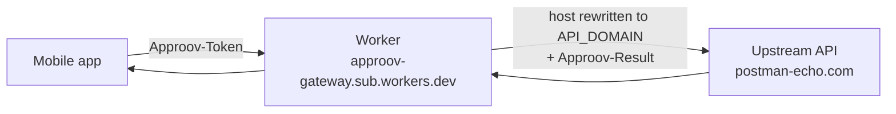
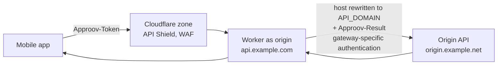
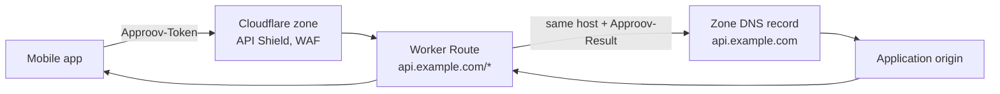
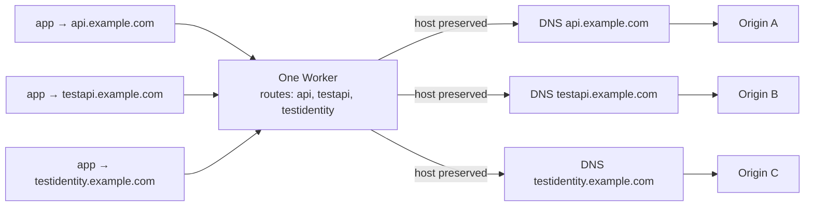
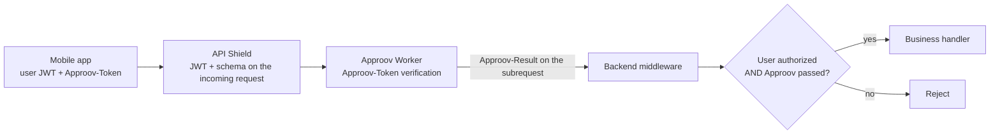

# Deployment Topologies

This guide maps the Worker's configuration onto the Cloudflare topologies it can be deployed in,
so you can pick one before writing any `wrangler.toml`. It also explains which upstream origin
each topology forwards to and why, which is the question that decides whether you need one Worker
or several.

- [Where configuration lives](#where-configuration-lives)
- [Who decides the upstream origin](#who-decides-the-upstream-origin)
- [Topology A — `workers.dev` subdomain](#topology-a--workersdev-subdomain)
- [Topology B — Custom Domain](#topology-b--custom-domain)
- [Topology C — Worker Route in front of an existing origin](#topology-c--worker-route-in-front-of-an-existing-origin)
- [Choosing a topology](#choosing-a-topology)
- [Protecting several API hostnames](#protecting-several-api-hostnames)
- [Where API Shield fits](#where-api-shield-fits)

---

## Where configuration lives

Configuration arrives from three places with three different granularities. Knowing which is
which explains most deployment questions:

| Layer | Set via | Granularity |
|---|---|---|
| `APPROOV_BACKEND_CONFIG` (secret) | `wrangler secret put` | **Per incoming hostname** — the `apis` map holds `{kid, isPassKeyPresent, isFailKeyPresent}` for each registered hostname, alongside the shared JWKS and ARC secrets |
| `[vars]` in `wrangler.toml` | deploy time | **Per deployment** — every behavioural toggle applies to the whole Worker |
| Zone, DNS, route, and API Shield settings | Cloudflare dashboard or `[[routes]]` | **Per hostname**, configured outside this repository |

Only key material is per-hostname. Everything in `[vars]` — `API_DOMAIN`, `API_PORT`,
`APPROOV_MODE` and the protection action variables,
`APPROOV_TOKEN_HEADER_NAME`, `APPROOV_TOKEN_AUDIENCE`,
`APPROOV_ACCEPT_DEFAULT_ACCOUNT_SECRET`, the token-binding settings, the message-signing
settings, `APPROOV_ECHO_MODE`, and `APPROOV_DEBUG` — is a single value for
the entire deployment.

Token *verification* is therefore already multi-hostname. The Worker resolves the verification
policy from the incoming hostname on every request:

```javascript
// src/worker/handle-request.js
apiPolicy = resolveApiPolicy(ctx, new URL(request.url).hostname)
```

A hostname that is absent from `APPROOV_BACKEND_CONFIG.apis`, has token checking disabled, or
still uses the default account secret without the compatibility switch fails closed with a
`500`. It never forwards unverified traffic.

## Who decides the upstream origin

`APPROOV_BACKEND_CONFIG` contains **no origin information**. Its `apis` map describes which
Approov keyset verifies each hostname; it says nothing about where that hostname's traffic should
go. It is also generated by `approov secret -getBackendConfig`, so the Worker cannot add origin
fields to it.

The upstream is decided in exactly one place — `src/http/proxy.js`:

```javascript
url.protocol = 'https:'
if (!ctx.apiPassthrough) {
  url.host = ctx.apiHost      // env.API_DOMAIN
  url.port = String(ctx.apiPort)
}
```

With `API_DOMAIN`, one deployment has one rewrite target. With `API_PASSTHROUGH` the incoming
host and port are kept (see [Protecting several API hostnames](#protecting-several-api-hostnames)). What differs between topologies is *what that target means*:

| Topology | The public hostname resolves to | Upstream reached by | Origin knowledge lives in |
|---|---|---|---|
| A — `workers.dev` | the Worker | rewriting the host to `API_DOMAIN` | `[vars]` |
| B — Custom Domain | the Worker (Worker-owned DNS) | rewriting the host to `API_DOMAIN` | `[vars]` |
| C — Worker Route | the zone's proxied DNS record | `API_DOMAIN` is set to the *same* hostname, so the rewrite is a no-op and Cloudflare routes the same-zone subrequest to the DNS origin | the zone's DNS record |

The scheme is always forced to `https:`, so a plaintext-HTTP upstream is not supported in any
topology.

## Topology A — `workers.dev` subdomain

The repository default: `wrangler.toml` declares no `[[routes]]` and no `custom_domain`, so the
Worker is published on `<name>.<subdomain>.workers.dev` and is itself the origin.



The public hostname is the `workers.dev` hostname, so **that** is the name the app calls and the
name that must be registered with Approov and present in `apis` — not the backend's hostname.
This is why the quickstart registers the gateway domain rather than the API domain.

```toml
# no [[routes]]; workers_dev defaults to true

[vars]
API_DOMAIN = "postman-echo.com"
API_PORT = "443"
# APPROOV_TOKEN_AUDIENCE = "approov-gateway.<CF_SUBDOMAIN>.workers.dev"
```

**Use for:** the quickstart, local and CI testing, and the deployed L2 suite in
[`test/e2e/`](../test/e2e/).

**Do not use for production.** A `workers.dev` hostname is not part of a Cloudflare zone, so it
has no API Shield, no WAF rules, no zone-level rate limiting, and no origin access controls. The
upstream also remains publicly reachable, so nothing prevents a client from skipping the Worker
and supplying its own `Approov-Result` unless you add an independent edge-to-origin control.

## Topology B — Custom Domain

`custom_domain = true` makes the Worker the origin for a hostname you own, and Cloudflare creates
a Worker-owned DNS record for it.



`API_DOMAIN` **must** name a different hostname from the incoming one. Pointing it back at the
Worker's own hostname makes the Worker fetch itself.

```toml
workers_dev = false

[[routes]]
pattern = "api.example.com"
custom_domain = true

[vars]
API_DOMAIN = "origin.example.net"
API_PORT = "443"
```

**Use for:** introducing a *new* public API hostname in front of an origin that keeps its own
separate name, including an origin outside Cloudflare entirely.

**Required alongside it:** the origin must authenticate this exact gateway path before trusting
`Approov-Result`. AOP authenticates the connection from Cloudflare, not execution of this Worker.
A public tunnel hostname has the same alternate-path requirement. Gateway-specific credential
or client-certificate dispatch requires a source extension in this version. See
[Backend Enforcement and Trusted Ingress](backend-enforcement.md).

## Topology C — Worker Route in front of an existing origin

The production topology, covered in detail in
[Deployment in Front of an Existing API Origin](existing-domain.md). The API hostname already has
a proxied DNS record pointing at the application server; a Worker Route inserts the Worker in
front of it without changing that record.



```toml
workers_dev = false

[[routes]]
pattern = "api.example.com/*"
zone_name = "example.com"

[vars]
API_DOMAIN = "api.example.com"   # same hostname the route matches
API_PORT = "443"
```

Note what `API_DOMAIN` is doing here: it is set to the hostname the request already arrived on,
so the host rewrite in `proxy.js` produces the URL it was given. **The forwarding in this
topology is already pass-through** — the Worker simply has to be told, once, which single
hostname to pass through to. Cloudflare resolves the same-zone subrequest against the zone's DNS
record, which is what reaches the origin with the right backend.

Two constraints are load-bearing:

1. **Leave `global_fetch_strictly_public` off.** With that compatibility flag enabled, the
   same-zone subrequest is sent back out through Cloudflare's public routing path and re-enters
   the Worker Route.
2. **Configure the route to fail closed**, so an exhausted Worker request allowance returns an
   error instead of bypassing verification and delivering unverified traffic to the origin.

**Use for:** production on an existing Cloudflare-proxied API hostname.

**Why it is preferred:** the route covers the public hostname itself, so no second public
hostname exists that could skip the Worker, and no gateway credential has to be added and
maintained. Trusted ingress is complete only once direct access to origin IPs and alternate
hostnames is closed as well.

Every annotation-mode topology also requires cache bypass before backend enforcement.
Outbound `cache: 'no-store'` does not guarantee bypass of another Cloudflare zone's cache.
Configure the applicable Cache Rules and origin policy, then exercise the
[staging cache test](backend-enforcement.md#cache-bypass-is-mandatory-before-enforcement) for each deployed topology.

## Choosing a topology

| Question | A `workers.dev` | B Custom Domain | C Worker Route |
|---|---|---|---|
| Is the Worker the origin? | Yes | Yes | No |
| Does the app call a hostname in your Cloudflare zone? | No | Yes | Yes |
| Can API Shield / WAF apply? | No | Yes | Yes |
| Must `API_DOMAIN` differ from the incoming hostname? | Yes | Yes | No — it is the same hostname |
| Is the Worker on the only public path to the origin? | No | No | Yes, once direct access to origin IPs and alternate hostnames is closed |
| Production ready? | No | With an added edge-to-origin control | Yes, with the origin closed as above |

## Protecting several API hostnames

Token verification already handles any number of hostnames from one deployment. Whether you can
also *forward* them from one deployment depends on whether they share an origin:

| Situation | Deployments needed today |
|---|---|
| Several hostnames, one shared origin | **One.** Add a `[[routes]]` entry per hostname, list every hostname in `apis`, and point `API_DOMAIN` at the shared origin. |
| Several hostnames, each with its own origin | **One**, with `API_PASSTHROUGH = "true"`. Without it, one per hostname, because `API_DOMAIN` is a single deployment-wide value. |
| Several hostnames needing different Approov policy | **One per hostname**, regardless of origins — `[vars]` cannot vary per hostname. |

The second row is the case tracked in
[issue #19](https://github.com/approov/approov-verifier-cloudflare-worker/issues/19): three
hostnames in one zone, each with its own origin DNS record, which before pass-through needed three
near-identical Workers differing only in route pattern and `API_DOMAIN`. The cost was not just
duplicated configuration — it was N uploads and N rotations of the same `APPROOV_BACKEND_CONFIG`
secret.

Setting `API_PASSTHROUGH = "true"` makes topology C's pass-through behaviour explicit instead of
hardcoded, so one deployment serves every route:



Each request verifies against its own hostname's keyset from `apis`, and each forwarded request
reaches its own origin because the zone's DNS records — not the Worker — hold the origin
mapping. No origin list is added to the Worker or to `APPROOV_BACKEND_CONFIG`.

This mode is valid **only** in topology C. In A and B the Worker is the origin for the incoming
hostname, so preserving that hostname would make the Worker fetch itself.

```toml
workers_dev = false

[[routes]]
pattern = "api.example.com/*"
zone_name = "example.com"

[[routes]]
pattern = "testapi.example.com/*"
zone_name = "example.com"

[[routes]]
pattern = "testidentity.example.com/*"
zone_name = "example.com"

[vars]
API_PASSTHROUGH = "true"
# API_DOMAIN must be absent — setting both is a startup error.
```

Every hostname must also appear in `APPROOV_BACKEND_CONFIG.apis`, or requests to the missing one
fail closed with a `500`. Register each with the Approov CLI before exporting the config:

```shell
approov api -add api.example.com -keySetKID "example-es256"
approov api -add testapi.example.com -keySetKID "example-es256"
approov api -add testidentity.example.com -keySetKID "example-es256"
approov secret -getBackendConfig approov-config.json
```

If a forwarded request comes back to the Worker instead of reaching the origin, the Worker returns
`508 Loop Detected` and logs that pass-through requires the Worker Route topology with
`global_fetch_strictly_public` disabled. Every forwarded request carries an
`Approov-Gateway-Hop: 1` header, which is how that re-entry is detected; a client-supplied value is
always replaced.

Two limits survive the change, because they come from `[vars]` being deployment-wide:

- `APPROOV_TOKEN_AUDIENCE` is a single expected `aud` value. Approov audiences are normally the
  API domain, so a deployment serving several hostnames cannot use a fixed audience check. Use
  `APPROOV_TOKEN_AUDIENCE_FROM_HOST = "true"` instead, which requires `aud` to equal each
  request's own hostname.
- Any hostname needing different enforcement, binding, or message-signing settings still needs
  its own deployment.

## Where API Shield fits

API Shield acts on the **incoming** client request at the zone level, so it composes with
topologies B and C only; a `workers.dev` hostname has no zone for it to attach to.

The responsibility split is fixed:

- **API Shield** validates the normal user or service credential (usually a JWT in
  `Authorization`) and the OpenAPI schema, for operations registered in Endpoint Management.
- **This Worker** validates `Approov-Token` against the incoming hostname's pass and fail
  keysets, plus optional token binding, message signing, and ARC annotations.
- **The backend** combines both and makes the final decision.



Two rules follow from the ordering and must not be worked around:

- **API Shield cannot see `Approov-Result`.** The Worker attaches it to the upstream subrequest,
  after the incoming-request phases have run. Never write an API Shield rule that depends on it.
- **Never point API Shield JWT validation at `Approov-Token`.** Approov needs per-domain policy
  and separate pass and fail key material to turn a correctly signed rejection into `FAIL`
  rather than an unclassified signature result, and API Shield does not document HS256 at all.

One detail worth knowing if you enable message signing: signature verification uses the
**inbound** request URL, so `@authority` is the public hostname the app signed. The upstream
rewrite happens afterwards and cannot invalidate a signature. This holds in all three topologies.

Follow the [API Shield deployment checklist](api-shield-deployment.md) for the configuration
order, [parallel JWT validation](parallel-jwt-validation.md) for the responsibility split and log
streaming, and the [verification matrix](api-shield-verification.md) before go-live.
