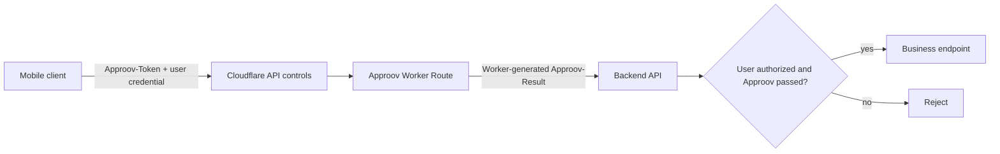

# Cloudflare API Shield with Backend-Enforced Approov Verification

This guide explains how to combine the Approov Cloudflare Worker with **Cloudflare API
Shield** while keeping the default backend-enforced annotation mode
(`APPROOV_MODE = "annotate"`). The two systems are complementary:

- API Shield validates the API contract and client credentials visible on the incoming request.
- The Approov Worker verifies the calling app instance and optional request-integrity proofs.
- The backend combines normal authentication and authorization with the Worker's authoritative
  `Approov-Result` and makes the final allow or deny decision.

It also covers how to forward worker validation logs to a log stream ingestion system (e.g., Datadog, Splunk, or Elasticsearch).

---

## Responsibility split

Configure API Shield independently for the controls it provides on the original client request:

- JWT validation for the user or service credential, commonly from `Authorization`.
- Schema validation for operations registered in Endpoint Management.
- mTLS, rate limiting, sequence controls, and other applicable API protections.

Configure the Worker for the Approov-specific checks:

- Approov pass-key and fail-key token verification for the incoming API domain.
- Optional token binding, commonly binding the Approov token to `Authorization`.
- Optional installation or account message-signature verification.
- Optional ARC annotations for backend risk analysis and observability.

These checks answer different questions. User JWT validation establishes the identity or session
represented by a credential. Approov verification establishes whether the software presenting
that credential is a valid app instance. An Approov pass does not grant user permissions, and a
valid user JWT does not prove app integrity.

## Request model



The diagram describes security responsibilities, not a promise about undocumented internal
ordering between every Cloudflare product phase. The integration must not depend on API Shield
re-evaluating headers that a Worker adds to its upstream subrequest.

Cloudflare documents API Shield JWT validation as extracting and validating JWTs from the
incoming client request, then exposing the result to the WAF. Cloudflare documents a Worker
Route as running a Worker in front of an existing origin, with the Worker's `fetch()` creating
the request sent to that origin. Consequently, `Approov-Result` is a backend-facing assertion:

- Do not configure an API Shield rule that assumes it can inspect the Worker-generated header.
- Do not expose the backend on a path that bypasses the Worker and permits a client to supply
  its own result.
- Make the backend reject missing or non-passing results as described in
  [Backend Enforcement and Trusted Ingress](backend-enforcement.md).

See Cloudflare's current documentation for
[JWT validation](https://developers.cloudflare.com/api-shield/security/jwt-validation/),
[JWT validation configuration](https://developers.cloudflare.com/api-shield/security/jwt-validation/api/),
and [Worker Routes](https://developers.cloudflare.com/workers/configuration/routing/routes/).

## Why API Shield JWT validation does not replace the Worker

Approov tokens use domain-specific verification policy and separate pass and fail key material.
The Worker verifies both key sources so a correctly signed Approov rejection becomes `FAIL`,
not an unclassified signature result. It also implements binding, message-signing, and ARC
semantics that a general JWT validator does not provide.

Cloudflare API Shield currently documents public-key JWT algorithms such as RS256 and ES256,
but not HS256. Even where an Approov domain uses a supported asymmetric algorithm, a generic
signature pass is not equivalent to the Worker's complete Approov decision. Use API Shield JWT
validation for the normal user or service JWT and use this Worker for `Approov-Token`.

## Default annotation mode

With these defaults, the Worker always forwards an authoritative result for backend enforcement:

```toml
APPROOV_MODE = "annotate"
```

The Worker removes any client-supplied `Approov-Result`, evaluates the request, base64-encodes
the result JSON, and attaches the replacement header to the request sent to `API_DOMAIN`.
Failures are deliberately forwarded so the backend can enforce policy and retain application
context. To block failures at the edge, use `APPROOV_MODE = "block"` with explicit layer actions.
Block mode removes `Approov-Result`. Replace middleware that requires the annotation before switching modes.
Keep application authentication and authorization checks.

Follow the [Cloudflare API Shield Deployment Checklist](api-shield-deployment.md) for the
complete configuration sequence.

---

## Log Stream Integration

The Approov Worker outputs structured console logs for both debugging and audit purposes. To redirect these logs to an external log ingestion and stream analytics system (such as Datadog, Splunk, or Elasticsearch), you can use Cloudflare's native logging capabilities:

### Method 1: Cloudflare Logpush
Cloudflare Logpush allows you to stream worker logs (Console messages, exceptions, and execution metadata) directly to external destinations in near real-time.

1. Navigate to the **Cloudflare Dashboard** -> **Analytics & Logs** -> **Logpush**.
2. Create a new Logpush job and select the **Workers Trace Events** dataset.
3. Choose your log stream destination (e.g., Datadog, Splunk, HTTP endpoint).
4. Review the exported fields before enabling the job. Workers Trace Events can include request metadata and exceptions, beyond safe console summaries.

Use a Tail Worker if the collector must receive only the allowlisted summary below.
Do not export complete trace events or rely on heuristic credential redaction to define a privacy policy.

### Method 2: Tail Workers
If you need custom log transformation or want to forward logs to a generic ingestion endpoint without using Logpush:

1. Create a lightweight **Tail Worker** in your Cloudflare account.
2. Configure it to listen to the main `approov-gateway` worker in your `wrangler.toml`:
   ```toml
   tail_consumers = [{ service = "my-log-tail-worker" }]
   ```
3. Enable `APPROOV_LOGGING_ENABLED = "true"` on the gateway to emit `approov.request` summaries.
4. Copy this Tail Worker and replace the collector URL. Add authentication that your collector requires.

The example accepts version 3 summaries and reconstructs only the listed core fields.
It validates enum strings and numeric fields. It omits plugins, client diagnostics, request objects, URLs, headers, exceptions, and unknown console objects.
Malformed messages and unsupported versions produce no export. Changes to the summary schema need an explicit allowlist update.

<!-- safe-approov-tail-example -->
```javascript
const enums = {
  mode: ['annotate', 'block', 'UNAVAILABLE'],
  action: ['block', 'forward', 'echo', 'error'],
  presence: ['MISSING', 'EMPTY', 'PRESENT', 'NOT_CHECKED'],
  verification: [
    'VERIFIED', 'NOT_CHECKED', 'ERROR', 'EXPIRED', 'INVALID_AUD', 'INVALID_ALG',
    'INVALID_SIG', 'MALFORMED', 'UNPARSABLE'
  ],
  attestation: ['PASS', 'FAIL', 'UNAVAILABLE'],
  binding: ['VALID', 'INVALID', 'DISABLED', 'ERROR', 'EMPTY_HEADER', 'MISSING_HEADER', 'MISSING_CLAIM', 'NOT_CHECKED'],
  signingMode: ['none', 'install', 'account', 'either', 'both', 'unknown'],
  signingStatus: [
    'VALID', 'NOT_REQUIRED', 'ERROR', 'INVALID', 'INVALID_CONTENT_DIGEST',
    'INVALID_INSTALL_KEY_CLAIM', 'INVALID_ACCOUNT_KEY_ID_CLAIM', 'INVALID_DEVICE_ID_CLAIM',
    'ACCOUNT_KEY_ID_MISMATCH', 'ACCOUNT_SECRET_NOT_CONFIGURED', 'MALFORMED_HEADERS',
    'MISSING_CONTENT_DIGEST', 'MISSING_HEADERS', 'MISSING_SIGNATURE_ENTRY', 'NOT_CHECKED'
  ],
  validation: ['PASS', 'FAIL', 'ERROR', 'NOT_EVALUATED']
}

const pick = (value, allowed) => allowed.includes(value) ? value : null
const status = value => Number.isInteger(value) && value >= 100 && value <= 599 ? value : null

function safeSummary (message) {
  let data = message
  if (typeof data === 'string') {
    if (data.length > 65536) return null
    try { data = JSON.parse(data) } catch { return null }
  }
  if (!data || typeof data !== 'object' || Array.isArray(data) ||
      data.event !== 'approov.request' || data.version !== 3) return null

  return {
    event: 'approov.request',
    version: 3,
    mode: pick(data.mode, enums.mode),
    action: pick(data.action, enums.action),
    token: {
      presence: pick(data.token?.presence, enums.presence),
      verification: pick(data.token?.verification, enums.verification)
    },
    attestation: pick(data.attestation, enums.attestation),
    binding: pick(data.binding, enums.binding),
    messageSignature: {
      mode: pick(data.messageSignature?.mode, enums.signingMode),
      status: pick(data.messageSignature?.status, enums.signingStatus)
    },
    validation: pick(data.validation, enums.validation),
    responseStatus: status(data.responseStatus),
    upstreamStatus: status(data.upstreamStatus),
    durationMs: Number.isFinite(data.durationMs) && data.durationMs >= 0 ? data.durationMs : null
  }
}

export default {
  async tail (events) {
    const summaries = []
    for (const event of events) {
      for (const log of Array.isArray(event?.logs) ? event.logs : []) {
        if (log?.level !== 'log' || !Array.isArray(log.message)) continue
        for (const message of log.message) {
          const summary = safeSummary(message)
          if (summary) summaries.push(summary)
        }
      }
    }
    if (summaries.length === 0) return
    await fetch('https://log-ingester.example.com/v1/logs', {
      method: 'POST',
      body: JSON.stringify(summaries),
      headers: { 'Content-Type': 'application/json' }
    })
  }
}
```

Cloudflare Tail events contain request metadata. Their redaction uses heuristics and can miss custom credentials or short query values.
The example therefore ignores request and exception fields entirely. See the [Tail handler fields and redaction rules](https://developers.cloudflare.com/workers/runtime-apis/handlers/tail/#tailrequest).

Run `npm run test:preflight` to exercise this exact example against synthetic sensitive events without a network request.

---

## Reference Links

* **[Main README](../README.md)**: Refer back to the main README for general configuration options, keyset setup, and deployment guides.
* **[Cloudflare Logpush Documentation](https://developers.cloudflare.com/logs/about/)**: Detailed information on setting up and managing Logpush jobs.
* **[Cloudflare Tail Workers Documentation](https://developers.cloudflare.com/workers/observability/tail-workers/)**: Learn how to implement custom tail workers to intercept and forward logs.
